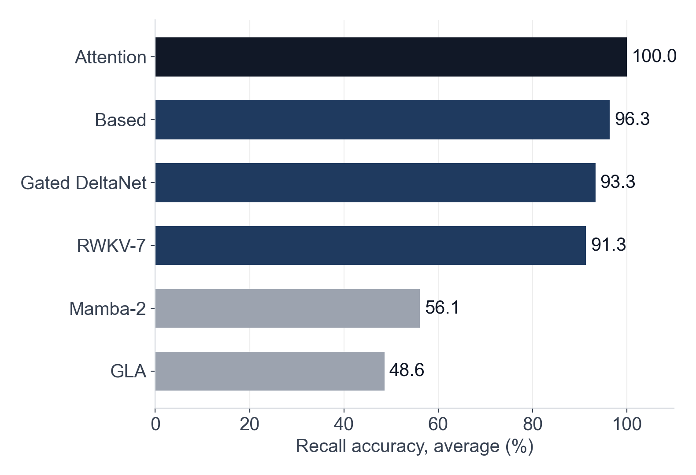
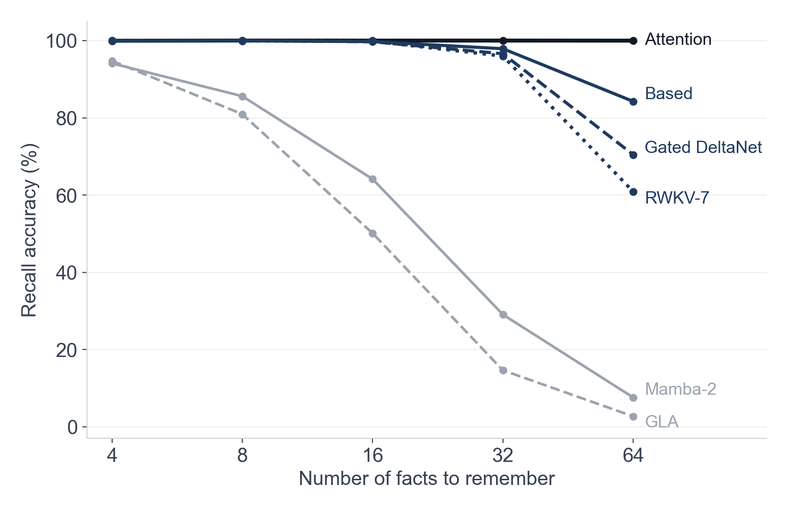

# Linear Attention and State-Space Models for Long-Context Recall

Fast language models (Mamba-2, linear attention, delta-rule models) keep a fixed-size memory, so they forget facts that attention can still look up. This repository runs six current methods from their official code on the same recall tests, on a laptop CPU, so you can start from the baseline table and try to beat it.

## Baseline table

MQAR recall test (zoology's own generator, laptop size). Score = mean accuracy over 5 test settings, from 4 to 64 key-value pairs.

| Method | Score | 64 facts (L256_kv64) |
|---|---|---|
| Attention | **1.000** | 1.000 |
| Based | 0.963 | 0.843 |
| Gated DeltaNet | 0.933 | 0.705 |
| RWKV-7 | 0.913 | 0.609 |
| Mamba-2 | 0.561 | 0.076 |
| GLA | 0.486 | 0.027 |

Attention recalls almost everything; the best fast models get 91-96%, and Mamba-2 and GLA get about half. With 64 facts every fast model drops, some to almost zero. The published order holds (details and the comparison with the papers in [BASELINES.md](BASELINES.md)).




Print the table from the stored runs:

```bash
python3 benchmark/official_table.py
```

## Methods and sources

| Method | Official code (pinned) |
|---|---|
| Mamba-2 | state-spaces/mamba `e9594ce` |
| Gated DeltaNet, GLA, RWKV-7 | fla-org/flash-linear-attention `cc4648a` |
| Based, attention, MQAR generator | HazyResearch/zoology `1ad20d1` |

Each CPU port is checked against the official torch reference (outputs and gradients): `python3 tests/check_official.py`.

## Quick start

```bash
pip install torch numpy einops opt_einsum transformers
bash data/download.sh                     # clones the pinned official repos into data/ext/
python3 tests/check_official.py           # ports vs official code
python3 -I benchmark/mqar_zoology.py method=gated_deltanet lr=1e-2
python3 -I benchmark/ruler_niah.py method=gated_deltanet lr=3e-3
bash reproduce.sh                         # every baseline run, then the table (hours on a laptop)
```

## Benchmarks

- **MQAR** (Zoology and Based papers), zoology generator: train (64,4), (128,8); test (64,4/8/16), (128,32), (256,64).
- **RULER-style NIAH**: RULER's 8 needle-in-a-haystack configs built as tokens. Train at length 128, test at 128 and 256. Attention is run; the other five are not run yet.
- **MQAR-LR** (extra): lengths 128-1024, with the first hand-written layers in `baselines/_old_sketches/`.

## Files

| Path | What |
|---|---|
| `baselines/official/` | CPU ports of the official layers and zoology's MQAR model |
| `benchmark/` | MQAR (zoology), RULER-style NIAH, table script, MQAR-LR extra |
| `env/` | task generators, recurrence engine, model and training loop |
| `data/download.sh`, `data/runs/` | pinned official repos; stored baseline runs |
| `tests/` | match checks |
| `reproduce.sh` | all baseline runs and the table |

Licenses: [LICENSES.md](LICENSES.md).
